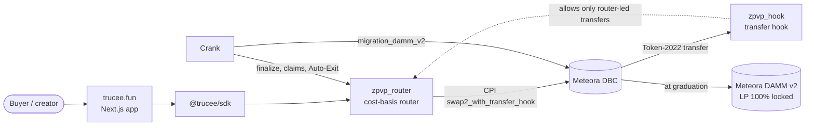

# Trucee

**No PvP until graduation.** Trucee is a Zero-PvP launchpad on [Meteora's Dynamic Bonding Curve](https://docs.meteora.ag/) (DBC), live on Solana mainnet. Before a token graduates, every buyer can exit at their cost basis minus the fee at cost and a 2-lamport haircut, so nobody can profit off the buyers who come after them.

| | |
| --- | --- |
| App (mainnet) | [trucee.fun](https://trucee.fun) |
| App (devnet) | [devnet.trucee.fun](https://devnet.trucee.fun) |
| Docs | [docs.trucee.fun](https://docs.trucee.fun) |
| X | [@truceefun](https://x.com/truceefun) |

This repository is the overview. The code lives in the repositories listed under [Repositories](#repositories).

## What Trucee changes before graduation

1. **Exit at cost.** Every holder can sell back through the Trucee router at any time before graduation. The router sells the tokens into the curve, parks the proceeds in a per-market buffer and refunds the holder's cost basis minus the fee at cost and a 2-lamport haircut.
2. **Gains wait for graduation.** When an exit sells above its cost basis, the difference stays in the buffer. Whatever is left when the curve completes is split among the open positions pro rata to their basis.
3. **Transfers wait for graduation.** A Token-2022 transfer hook rejects any transfer whose top-level instruction is not the Trucee router, so every trade before graduation goes through it.

At graduation, DBC itself revokes the transfer hook on the swap that completes the curve. The token becomes a plain Token-2022 token, its liquidity migrates to a Meteora DAMM v2 pool with the LP 100% locked, and it trades freely.

On the same simulated order flow (300 random curves, 1% fee, a sniper buying first, 60 retail buys), a sniper averages **+10.57 SOL** on a plain DBC curve and **−0.06 SOL** through the Trucee router, with no profit in any of the 300 runs ([Research & data](https://docs.trucee.fun/research-and-data)).

## How it uses Meteora DBC

Trucee does not fork or modify DBC. It adds two small Anchor programs and uses DBC's own transfer-hook pools, swap, hook revocation and DAMM v2 migration.



- **Stock DBC transfer-hook pools.** Each launch is a DBC transfer-hook config (`create_config_with_transfer_hook`) and Token-2022 pool (`initialize_virtual_pool_with_token2022_transfer_hook`) whose base mint's hook is `zpvp_hook`.
- **Every trade is a CPI into `swap2_with_transfer_hook`.** The router records the cost basis on a buy and refunds `basis − ⌈basis × fee⌉ − 2` lamports from the market's buffer on an exit, with no slippage.
- **One preset, checked on-chain.** `init_market` opens a market only for the Zero-PvP preset: a static quote-side fee of at most 1%, dynamic supply, no creator allocation, an immutable mint authority, no migration fee, DAMM v2 migration and 100% permanently locked LP. Anything else fails (`PresetNotAllowed`, `FeeTooHigh`).
- **Hook revoked by DBC at graduation.** The transfer restriction ends on-chain without any action from the team.
- **DAMM v2 migration by our crank.** Meteora's keepers migrate SOL pools from a 10 SOL threshold; Trucee's permissionless crank also migrates smaller pools, finalizes markets, pays surplus claims and runs Auto-Exit.
- **Router v5 features.** Auto-Exit (a deadline after which anyone can trigger your exit at cost before graduation), a 20% Anti-Whale cap per position, DBC's Native Referral, and xStock quotes (TSLAx, NVDAx) next to SOL.

## Live on Solana mainnet

Both programs use the same IDs on mainnet and devnet.

| Program | Address | Mainnet bytes | Deployed |
| --- | --- | --- | --- |
| `zpvp_router` | [`D4sk6wwELD6cmd7tv6hE4hkxQP8SF8tjdegYym8iWNNb`](https://explorer.solana.com/address/D4sk6wwELD6cmd7tv6hE4hkxQP8SF8tjdegYym8iWNNb) | 439,904, sha256 `370c0756…`, executable hash `e9c0ce9d55ca7844c2d49b1d82629eb0ba6e695cf793f50878c751f3226bc918` | 2026-10-12, slot 456095594 |
| `zpvp_hook` | [`CUNNV1MqVB53N4jWn91uVFXm1dBSyaynR6iBCbufJWMS`](https://explorer.solana.com/address/CUNNV1MqVB53N4jWn91uVFXm1dBSyaynR6iBCbufJWMS) | 210,536, sha256 `1dbde487…`, executable hash `a3e219cbf35866039c7929bc83b7d1707cbdca1fbad38246f0b631df2e2ee0a9` | 2026-10-12, slot 456095540 |

Both are reproducible `solana-verify build` artifacts. Check the on-chain bytes with:

```bash
solana-verify get-program-hash -u https://api.mainnet-beta.solana.com D4sk6wwELD6cmd7tv6hE4hkxQP8SF8tjdegYym8iWNNb
solana-verify get-program-hash -u https://api.mainnet-beta.solana.com CUNNV1MqVB53N4jWn91uVFXm1dBSyaynR6iBCbufJWMS
```

**Trust.** The programs are not independently reviewed. Both are upgradeable, and the upgrade authority on both clusters is one team-held key, `CamCkeR9iqBij1ZyrEYj9mp6emQtpMVdWWVCUX46tFLE` (`solana program show <PROGRAM_ID> --url mainnet-beta`). The invariants, tests and known limits are in [Security](https://docs.trucee.fun/security).

### First mainnet market

[Trucee Cat (TCAT)](https://trucee.fun/t/EFRXppU9U9pniwDVCD1kaosNQV3HzhKqY7XrcuMvFmC2), a SOL market with a 1% fee and a 10 SOL graduation threshold, opened on 2026-10-12. Amounts are read from the router's events.

| Step | Result | Transaction |
| --- | --- | --- |
| Launch | Market opened on the Zero-PvP preset | [`mK7SEsWt…zJgs94Ed`](https://explorer.solana.com/tx/mK7SEsWt4s2Z62DzUyWmqwLnWVeNbAcsg96m59T8T9qSvT1firgabonXrWUHwf4nPCTdG9CrvMhbDH5zJgs94Ed) |
| Buy 0.1 SOL | Basis 98,999,984 lamports | [`DJDAZsQJ…oCZxhSTu`](https://explorer.solana.com/tx/DJDAZsQJwa4Qw55YqpeeL1iiPdg8uFxewDmqUynLijAdyoyoSqq4f3tPt1NestbCWzUMUiaP1tV57WfoCZxhSTu) |
| Auto-Exit on | Deadline 24 hours ahead | [`3gVvxdLv…YoEcQ8hL`](https://explorer.solana.com/tx/3gVvxdLvHeeA7o986f9Ns6tgoP4ULP2sjgqqS4a3EoNKFnenfFpthCrKmU4bGNZkSiUqE6Qw1XxgHVSFYoEcQ8hL) |
| Exit at cost | Refund 98,009,982 = 98,999,984 − 990,000 (1% fee, rounded up) − 2 | [`j3NNdaFL…UsDYL3ng`](https://explorer.solana.com/tx/j3NNdaFLAwXN4QydtrmnsX68Qno47vTEHX6UjEvxBLsFPJToYsJMseXn9qY3e7u1uzqkhgTcfxCUBwRUsDYL3ng) |

The full journey, and the devnet run that covers graduation, DAMM v2 migration and claims, is in [For traders → Proof on mainnet](https://docs.trucee.fun/for-traders#proof-on-mainnet).

## Repositories

| Repository | What it is |
| --- | --- |
| [trucee-programs](https://github.com/trucee-fun/trucee-programs) | The two Anchor programs: `zpvp_router` (cost-basis router) and `zpvp_hook` (Token-2022 transfer hook) |
| [trucee-sdk](https://github.com/trucee-fun/trucee-sdk) | `@trucee/sdk`, the TypeScript client: accounts, events, quotes, launch and trade builders |
| [trucee-app](https://github.com/trucee-fun/trucee-app) | The Next.js web app behind trucee.fun |
| [trucee-worker](https://github.com/trucee-fun/trucee-worker) | The permissionless crank: finalize, DAMM v2 migration, surplus claims and Auto-Exit |
| [trucee-sim](https://github.com/trucee-fun/trucee-sim) | Python port of DBC swap math, the refund model, the solvency fuzz and the sniper simulation |
| [trucee-litesvm-diff](https://github.com/trucee-fun/trucee-litesvm-diff) | Test suites that run the real DBC program in LiteSVM, and the differential replay against the Python port |
| [trucee-docs](https://github.com/trucee-fun/trucee-docs) | The source of [docs.trucee.fun](https://docs.trucee.fun) |

The code repositories are private for now; the reviewers of the Meteora DBC track have read access.

## License

[MIT](LICENSE)
